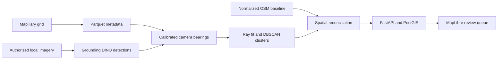

# StreetDelta

Review possible map changes from street-level imagery. StreetDelta combines camera bearings across multiple views, compares the resulting positions against a map baseline, and serves a ranked Chicago review queue through FastAPI, PostGIS, and MapLibre.

[](https://github.com/jatinmallarapu/StreetDelta/actions/workflows/ci.yml) [MIT license](LICENSE)

| Evaluation | Dataset | Result |
| --- | --- | --- |
| Geolocation | 60 synthetic Chicago-coordinate objects, 240 bearing rays | 60 recovered, 0.28 m median, 0.47 m p90 |
| Change ranking | 30 synthetic proposals | Precision@25 = 1.00. Precision@50 needs 50 ranked candidates |
| Perception ablation | Hand-labelled Chicago images and MTSD crops | Pending |
| Real map changes vs Mapillary | Frozen human-labelled Chicago set | Pending |

The offline fixture uses generated camera rays, a mock map layer, and known points. Objects are spaced to avoid ambiguous associations, the camera centers are exact, and the headings include seeded noise. These numbers measure recovery under those conditions. The real Chicago mAP, geolocation error, and advantage over Mapillary remain unmeasured.



## Run the Chicago demo

```bash
make up
```

Open `http://127.0.0.1:8000`. Filter for **Changed**, open a speed-limit mismatch, inspect the contributing view IDs, then accept or reject it. PostGIS stores decisions and audit events. The API blocks exporting synthetic edits. The basemap comes from OpenStreetMap and requires internet access. The review list still works when the map renderer is unavailable.

For a Python-only demo with in-memory review state:

```bash
python -m pip install -e '.[dev]'
make test
make eval
make serve
```

## API

| Route | Behavior |
| --- | --- |
| `GET /changes?bbox=west,south,east,north&type=changed&min_conf=0.60` | Returns confidence-ranked GeoJSON |
| `GET /features/{id}` | Includes contributing image IDs, fit residual and map value |
| `POST /changes/{id}/review` | Accepts a JSON decision of `accept` or `reject` |
| `GET /changes/export.osc` | Creates a local OSC proposal for supported, accepted new sign nodes in live mode |
| `GET /tiles/changes/{z}/{x}/{y}.pbf` | PostGIS-generated Mapbox Vector Tiles for the change layer |

The exporter excludes synthetic candidates, removals and modifications. It never connects to the OSM write API.

## Process your data

The study bbox covers approximately 13 km² around the Loop, West Loop and River North. Set a documented Mapillary client token in your shell and install `.[ingest,perception]`. Keep the token, images and extracted third-party metadata local.

```bash
make ingest
python -m streetdelta.perception data/raw/*.jpg --revision MODEL_COMMIT_SHA > runs/detections.jsonl
python -m streetdelta.live_pipeline --images runs/mapillary.parquet --detections runs/detections.jsonl --baseline runs/osm-points.json --out runs/candidates.json
```

Image names must use their Mapillary IDs. Add reviewed OCR values to speed-limit detections before triangulation. Keep camera conventions and source attribution with each input. The Airflow example runs the metadata refresh. For PostGIS staging, run against a fresh live database initialized with `sql/schema.sql`, pass `--write-postgis`, then serve with `STREETDELTA_MODE=live`. The importer commits image metadata, detections, the baseline, fused observations and candidates in one transaction. Rerunning the same input preserves review decisions.

[Build a map baseline](docs/baseline.md) · [Confidence and architecture](docs/architecture.md) · [Evaluation protocol](docs/method.md)

## Limitations and remaining experiments

The real-data path requires authorized imagery, a source map extract and labelled evaluation. DINOv3 probe and LoRA training, SAM 2 sequence tracking, OCR model inference, VLM verification, Mapillary feature baseline evaluation, and TensorRT conversion are future milestones. The repository includes a generic ONNX runtime benchmark for exported models. GPS drift, rare signs, adjacent duplicate objects, and night or occluded imagery need targeted error slices. Probe GPS traces are a separate source for testing road geometry changes.

OpenStreetMap data and tiles have attribution and usage requirements. Mapillary imagery has separate terms. No source imagery or external map data is included in the repository. [OpenStreetMap copyright](https://www.openstreetmap.org/copyright) · [Mapillary](https://www.mapillary.com/)
